<p align="center">
  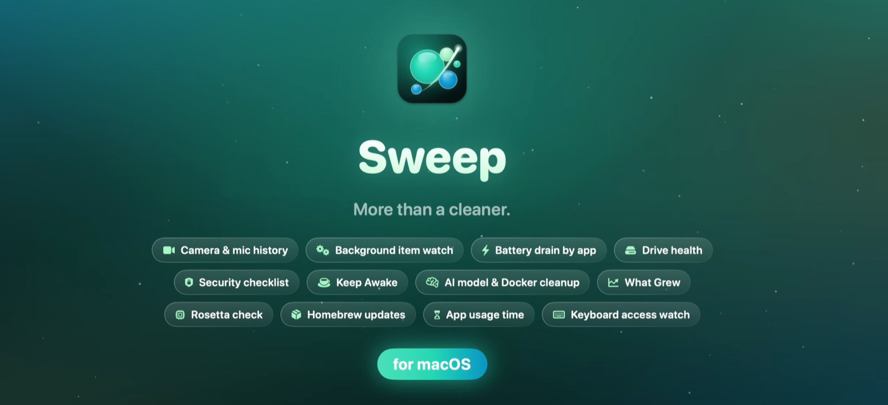
</p>

<h3 align="center">Clean, protect and understand your Mac. Free and open source.</h3>

<p align="center">
  <a href="../../releases/latest"></a>
  <a href="https://youtu.be/7XYMyBQJFTM"></a>
</p>

<p align="center">
  
  
  <a href="LICENSE"></a>
  
</p>

<p align="center">
  <a href="#install"><b>Install</b></a> ·
  <a href="#features">Features</a> ·
  <a href="#safe-by-design">Safe by design</a> ·
  <a href="#build-from-source">Build from source</a> ·
  <a href="CONTRIBUTING.md">Contribute</a> ·
  <a href="#support-sweep">Support</a>
</p>

---

Sweep finds the junk, big files and forgotten leftovers filling your Mac, checks it for malware and risky
settings, keeps every app up to date, and shows you what your Mac does while you're not looking. It's a
native SwiftUI app, it runs entirely on your Mac, and nothing is ever removed until you've reviewed it.

<!-- HIGHLIGHT-REEL: the 30-second video that plays right here goes on the next line (see docs/DEVELOPMENT.md, Releasing). -->

<p align="center">
  <a href="https://youtu.be/7XYMyBQJFTM">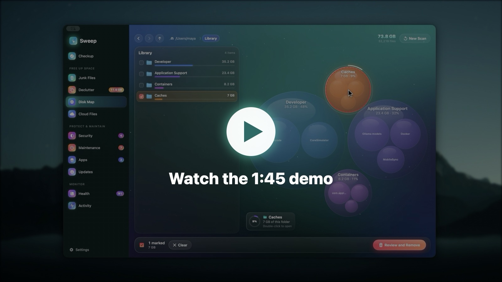</a>
</p>

## One checkup for your whole Mac

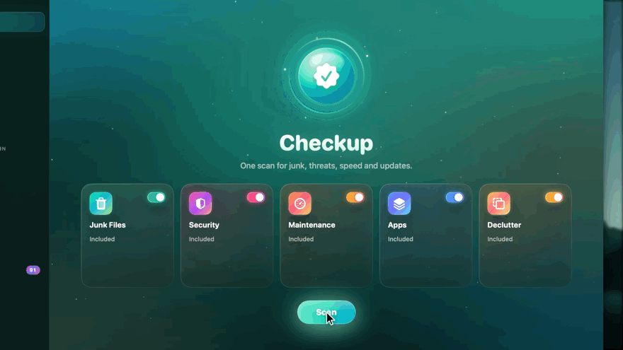

Press **Scan** once: Junk Files, Security, Maintenance, Apps and (if you like) Declutter run one after another,
and each card lights up with what it found. Open any card to review it, or run everything at once.

## Features

### Junk Files: gigabytes back, safely

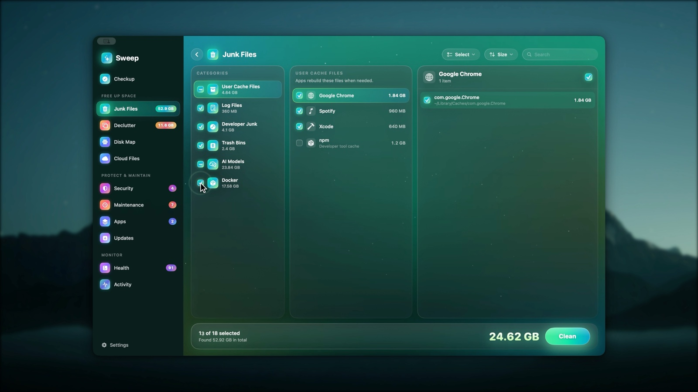

- App and system caches, logs and crash reports, the Trash, old iPhone backups and downloaded installers.
- **Developer junk**: Xcode DerivedData, simulators, device support files, package manager caches.
- **Local AI models** from Ollama, LM Studio and Hugging Face, including the same model kept twice by two apps.
- **Docker**: build cache, unused images and stopped containers, cleaned with Docker's own commands. Volumes are never touched.
- Review every category, group and file before anything goes. Junk can go to the Trash instead (Settings).

### Disk Map: see where your space went

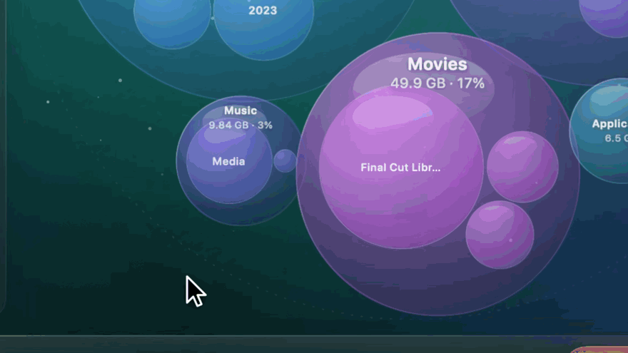

- A live bubble map of any disk or folder. Bigger bubble, bigger folder; each shows its share at a glance.
- Hover for details, double-click to open a folder, tick anything to remove it with a full removal log.
- **What Grew**: every scan is remembered, so the next one shows what grew and narrows it down to the folder that explains it.
- **System Data, explained**: what macOS counts as System Data on *your* Mac, who looks after each part, and where to act.

<table>
  <tr>
    <td>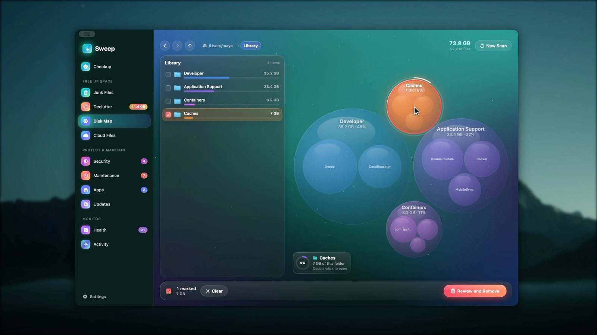</td>
    <td>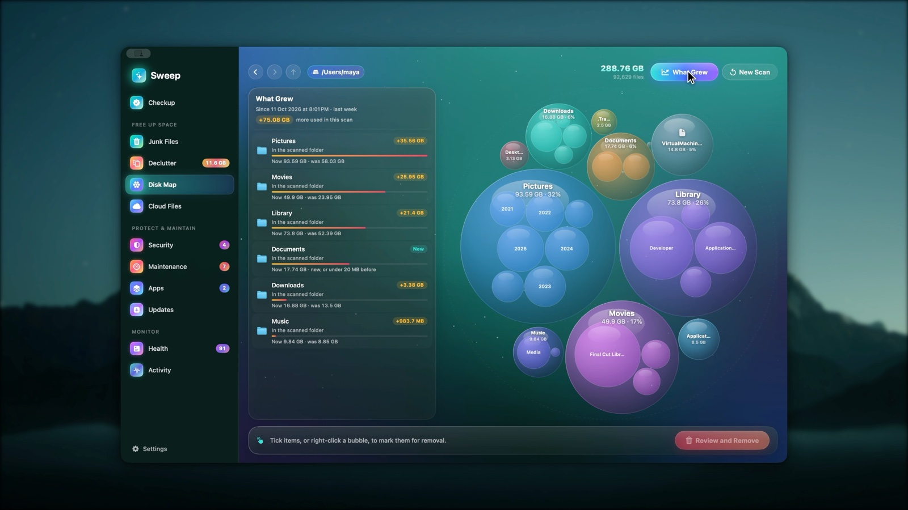</td>
  </tr>
</table>

### Apps: uninstall completely, catch what's left behind

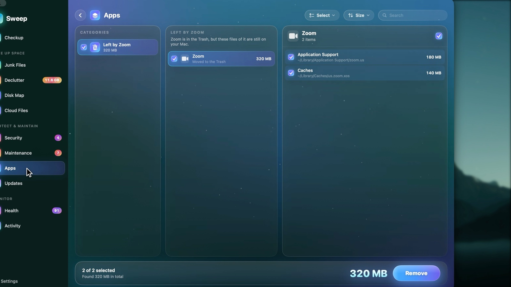

- Remove any app together with the caches, preferences and support files it spread around.
- Drag an app to the Trash and Sweep finds what it left behind, ready to review.
- Find leftovers of apps you deleted long ago, and apps you haven't opened in months.
- **Rosetta check**: spot Intel-only apps that will stop opening once Rosetta goes away.

### Updates: every app in one list

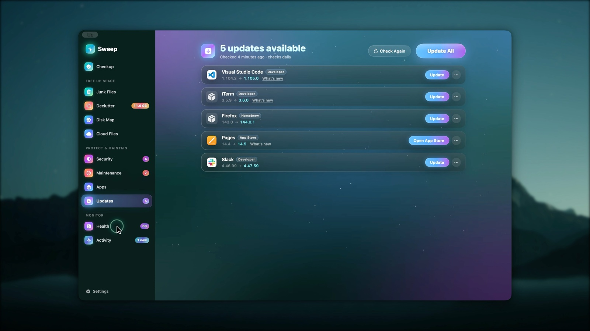

Updates from each app's own update feed (signature checked), the App Store and Homebrew, in one list.
**Update All** asks before quitting open apps and reopens them afterwards. Release notes, skip a version,
or ignore an app.

### Health: a live score with reasons

<table>
  <tr>
    <td>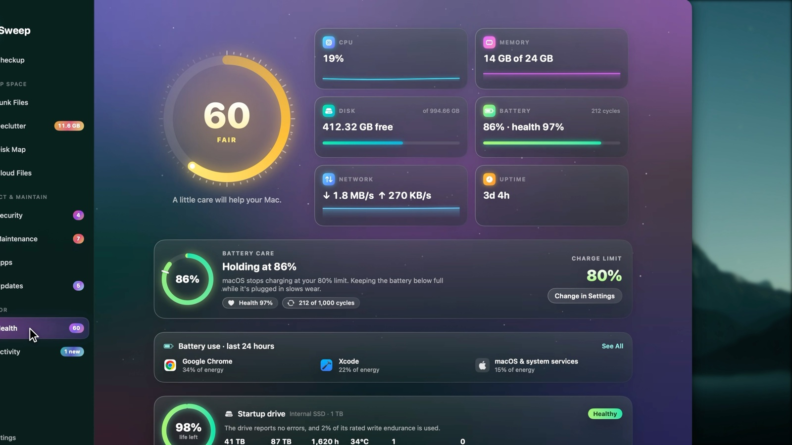</td>
    <td>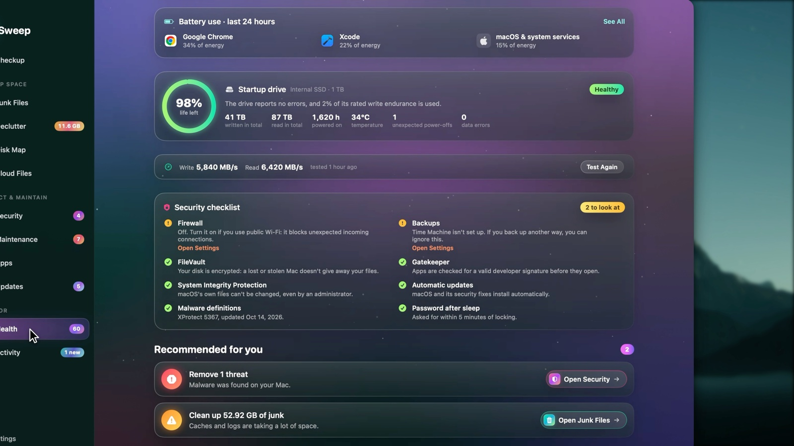</td>
  </tr>
</table>

- A transparent 0–100 health score with recommendations that open the right page.
- Live CPU, memory, disk, battery and network readings with sparklines.
- **Battery Care**: health, cycles and the charge limit macOS applies.
- **Drive Health** from the SSD's own health log (life left, data written, temperature, errors), plus a real drive speed test.
- **Security checklist**: FileVault, firewall, Gatekeeper, SIP, automatic updates, XProtect's age, password after sleep and backups, each with a fix.

### Activity: what your Mac did while you weren't looking

<table>
  <tr>
    <td>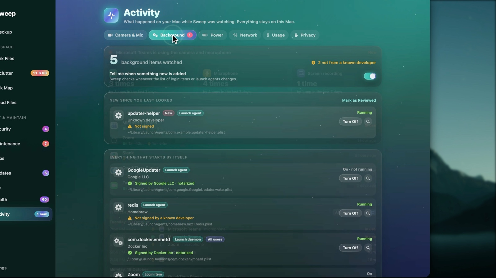</td>
    <td>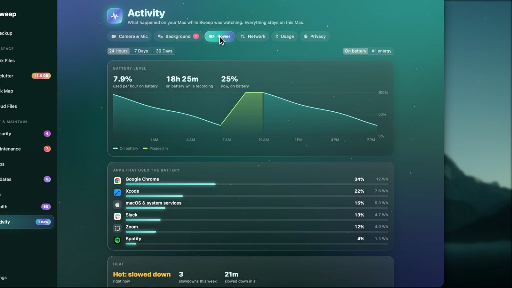</td>
  </tr>
  <tr>
    <td>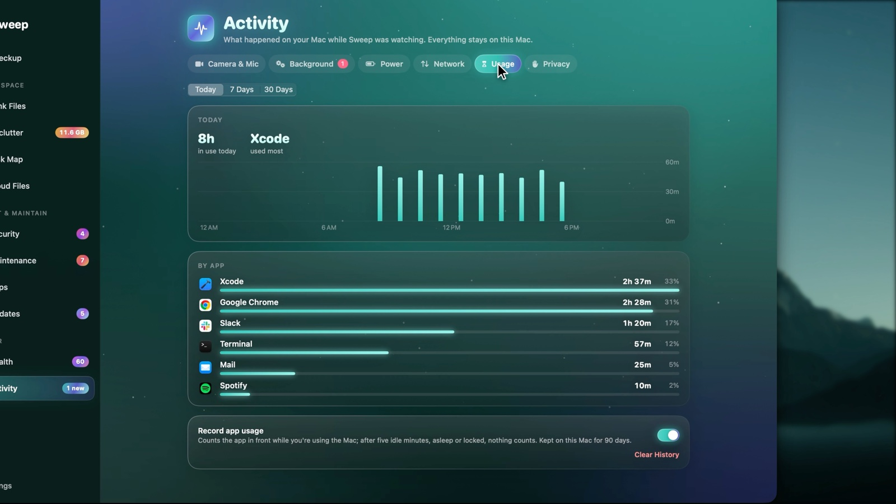</td>
    <td>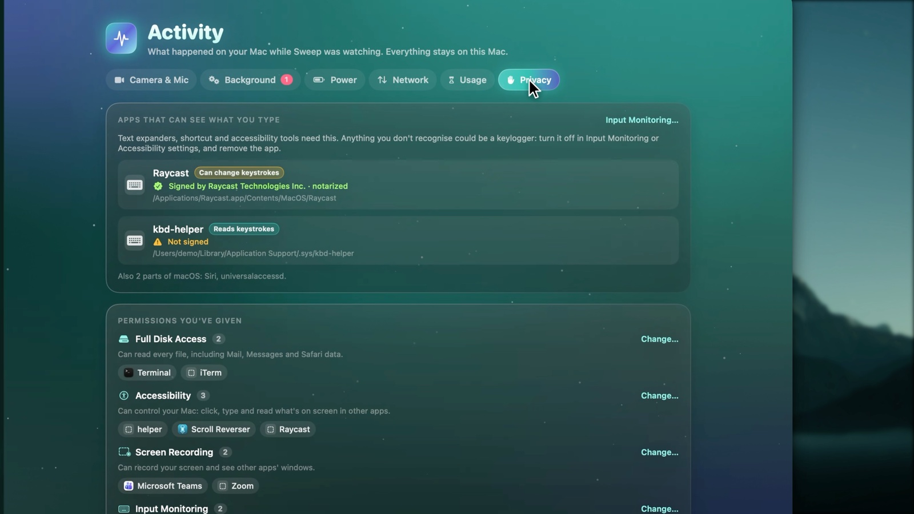</td>
  </tr>
</table>

- **Camera & microphone history**: every use, by which app, when and for how long.
- **Background items**: everything that starts by itself, who signed it, whether it runs, and a flag when something new appears.
- **Power**: battery drain by app, battery level over time, and every time the Mac slowed down because of heat.
- **Network**: data used by each app, with a warning on a phone hotspot.
- **Usage**: how long each app was in front, by day and hour.
- **Privacy**: apps that can see what you type, and every permission you've given.

### In the menu bar

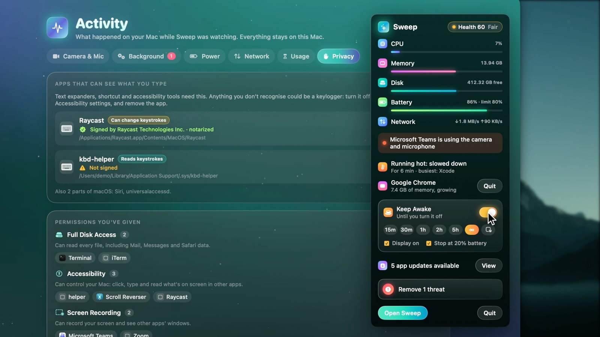

Live readings, who's using the camera, and alerts macOS doesn't give you: an app stuck at full CPU, a memory
hog, the Mac slowing down from heat, low AirPods or mouse battery. **Keep Awake** keeps your Mac (and
optionally the display) awake for a while, until you stop it, or while a chosen app is open.

### And also

- **Security**: a malware scan using Apple's own XProtect rules (plus your own YARA rules), risky startup items, browser history and cookies, and a quarantine you can restore from.
- **Maintenance**: DNS flush, freeing memory, Mail database tidy-up and more, plus login items.
- **Declutter**: exact duplicates, look-alike photos, and large or old files you've forgotten.
- **Cloud Files**: free the local copies of iCloud Drive, Google Drive, OneDrive and Dropbox files without deleting them.
- **Automation**: scheduled checkups, and auto-tidy rules for Downloads and screenshots.
- **Tweaks**: hidden macOS settings (Finder, Dock, screenshots), each one undoable.
- **Command line**: `sweep lens ~/Downloads --top 20` shows where the space goes, also as JSON.

## Safe by design

- **Nothing is removed without your review.** Every scan ends in a list you can check, change or cancel.
- **The Trash is the default** for anything you might want back (AI models, Disk Map removals, auto-tidy).
- **No surprises across disks.** Scans never cross into other volumes, never follow symlinks and never download iCloud files.
- **No account, no analytics, no tracking.** Sweep only goes online to check for app updates: each app's own update feed and the App Store.
- **Open source.** Read exactly what it does before you give it Full Disk Access.

## Install

1. [Download the latest **Sweep.dmg**](../../releases/latest), open it, and drag **Sweep** to **Applications**.
2. Open Sweep. This build isn't notarized yet, so the first time macOS says it can't check the app:
   open **System Settings → Privacy & Security**, scroll down, and click **Open Anyway** next to Sweep.
3. For full scans, give Sweep **Full Disk Access** in **System Settings → Privacy & Security → Full Disk Access**.
   Without it, Sweep still works and marks protected folders as "No access".

Requires **macOS 14 Sonoma or later**. The animated background needs macOS 15; macOS 14 gets a softer fallback.

## Build from source

You need Xcode 16 or later (Swift 6).

```sh
git clone https://github.com/amar97march/sweep.git
cd sweep
swift test                            # the whole test suite
scripts/make-app.sh && open .build/Sweep.app
```

`scripts/make-dmg.sh` builds the same disk image that's on the Releases page. More on the architecture,
the screenshot harness and how the scanner stays fast and correct: [docs/DEVELOPMENT.md](docs/DEVELOPMENT.md).

## Contributing

Bug reports, ideas and pull requests are welcome. Please read [CONTRIBUTING.md](CONTRIBUTING.md) first:
it explains the few rules that keep Sweep safe to run on people's Macs.

## Support Sweep

Sweep is free, and I build it in my spare time. If it helped you:

- **Star this repo** so more people can find it.
- **Share it** with a friend whose Mac keeps running out of space.
- **[Buy me a coffee](https://buymeacoffee.com/amar97march).** It goes towards an Apple Developer account, so
  Sweep can be notarized and open without the "Open Anyway" step.

## Licence

Sweep is released under the [GNU General Public License v3.0](LICENSE). Third-party code used in Sweep is
listed in [THIRD_PARTY_NOTICES.md](THIRD_PARTY_NOTICES.md).
